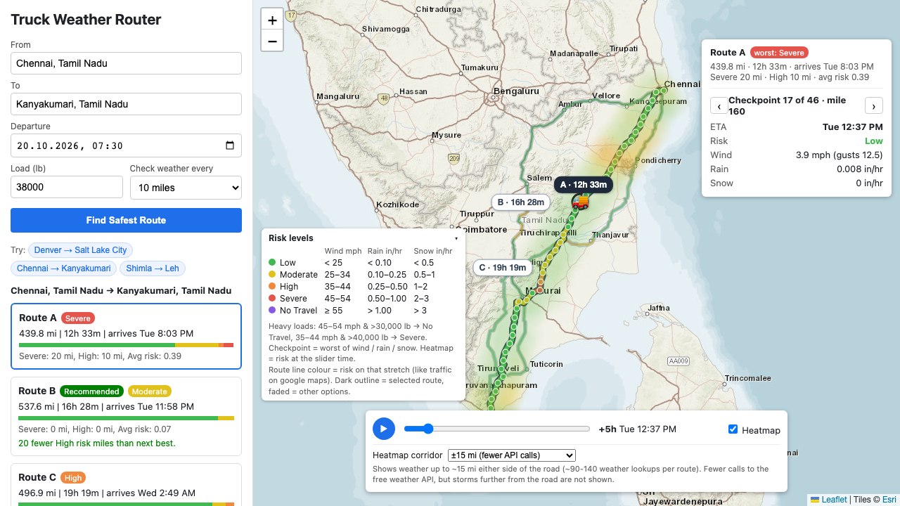

# Truck Weather Router

Spotter take-home (React + Django). Picks the safest truck route between two places using the forecast weather at each checkpoint **for the time the truck gets there**, the load weight, and travel time.



## What it does (requirement → where)

| Requirement | In the app |
|---|---|
| Origin, destination, departure, load | Form on the left. From / To suggest towns and cities (US + India) as you type. One-click example trips picked for snow, wind and rain |
| 3 route options from a routing API | TomTom truck routing, 3 route cards + 3 lines on the map |
| Weather every 10 / 25 / 50 mi at the truck's ETA | "Check weather every" select. Each checkpoint uses the forecast hour nearest its ETA |
| Risk from the risk / load rules | Every checkpoint, the route line colour, the card's risk bar. The legend shows the thresholds |
| Recommend the best route | "Recommended" badge + one line saying why and what it costs in time ("Lower average risk than Route A (0.14 vs 0.28), 4h 25m longer.") |
| Routes, checkpoints, risk levels, ETAs, summaries on the map | Risk-coloured route lines, checkpoint dots on every route (hover = ETA + risk; the selected route's are bigger), route labels with the driving time, panel on the map with the route summary + selected checkpoint. Times show their timezone |
| Heatmap along the corridor with a 0–48 h slider | Heatmap for the selected route, slider + ▶ play, a 🚚 shows where the truck is at that time |

## Run it locally

Needs Python 3.13, Node 22, and a free TomTom key (developer.tomtom.com → API key with Routing). Photon, Open-Meteo and the Esri tiles need no key.

```
cd backend
python -m venv venv && source venv/bin/activate
pip install -r requirements.txt
export TOMTOM_API_KEY=<your key>
python manage.py runserver                 # http://localhost:8000
python manage.py test planner              # 16 tests, no network needed
```

```
cd frontend
npm i
npm run dev                                # http://localhost:5173
```

Optional, tracing (needs Docker):

```
docker compose up -d                       # Jaeger UI on http://localhost:16686
OTEL_EXPORTER_OTLP_ENDPOINT=http://localhost:4318 python manage.py runserver
```

### Settings (environment variables)

| Variable | Where | Default | What |
|---|---|---|---|
| `TOMTOM_API_KEY` | backend | none, **required** | routing. Without it every plan fails with "routing or weather service failed" |
| `CORS_ORIGINS` | backend | `http://localhost:5173` | frontend URL(s), comma separated |
| `DEBUG` | backend | `1` | `0` in production |
| `SECRET_KEY` | backend | dev value | set in production |
| `ALLOWED_HOSTS` | backend | `*` | comma separated |
| `REDIS_URL` (or `KV_URL`) | backend | not set = in-memory cache | shared cache, needed when hosted serverless (Vercel), see Deploy |
| `OTEL_EXPORTER_OTLP_ENDPOINT` | backend | not set = no traces sent | e.g. `http://localhost:4318` for Jaeger |
| `OTEL_EXPORTER_OTLP_HEADERS` | backend | none | auth for a hosted tracing backend |
| `LOG_SPANS` | backend | not set | `1` = also write each span's name + duration to the log (for hosting without a tracing backend) |
| `VITE_API_URL` | frontend | `http://localhost:8000` | backend URL (in `frontend/.env.local` locally) |

## What is where

```
backend/
  api/index.py           Vercel entry point (serves the Django wsgi app)
  vercel.json            sends every path to it, 60 s time limit
  truckroute/            Django project only: settings, root urls, wsgi
    telemetry.py         OpenTelemetry setup (traces + trace id in logs)
  planner/               the app, all the actual code
    urls.py              /api/plan/, /api/heatmap/, /api/places/
    views.py             API layer: validate the request, call services, return JSON + status codes
    services.py          business logic: checkpoints + ETAs, risk rules, ranking, 3rd route, heatmap grid, place matching
    clients.py           external APIs (the "data layer", there's no db): TomTom, Photon, Open-Meteo, caching, retries
    tests.py             risk boundaries, load rules, ranking + reason text, checkpoint spacing, place matching,
                         heatmap input checks, weather retries / pause, rate limit
docker-compose.yml       Jaeger for local tracing
frontend/src/
  App.jsx                state + requests (quick plan, full plan, heatmaps), play loop, selection
  constants.js           API url, map tiles, risk colours / names, time formatting (with timezone)
  heatLayer.js           custom Leaflet canvas layer for the heatmap
  components/
    TripForm.jsx         form + example trips
    PlaceInput.jsx       From / To field with suggestions
    RouteCards.jsx       route cards + loading skeletons
    RouteMap.jsx         map: risk-coloured route lines, checkpoints on every route, truck, route labels
    HeatmapLayer.jsx     React wrapper around heatLayer.js, blends between hours
    TimeSlider.jsx       0–48 h slider, play, heatmap corridor choice
    CheckpointPanel.jsx  panel on the map: route summary + selected checkpoint
    Legend.jsx           risk thresholds, load rules, what the colours mean
```

## API

All JSON. Errors are `{"error": "..."}`.

| Endpoint | Body / query | Returns |
|---|---|---|
| `POST /api/plan/` | `origin`, `destination` (text, or a picked place `{name, lat, lon}`), `depart_at` (ISO), `weight` (lb), `interval_mi` (10/25/50), `quick` (optional: main route only) | places used, routes with checkpoints (mile, ETA, weather, risk, reasons), summaries, recommended route + why |
| `POST /api/heatmap/` | `depart_at`, `weight`, `lines` (1–3 routes as `[[lat, lon], ...]`), `rows` (1 = ±15 mi, 2 = ±30 mi) | grid points + risk 0–1 for each of 49 hours |
| `GET /api/places/?q=` | at least 2 characters | up to 6 matching towns / cities (US + India) |

Status codes: `400` bad input, `422` place not found / no truck route, `429` over the per-IP limit (per minute: 12 plans, 30 heatmaps, 60 place searches), `502` an outside API failed, `503` Open-Meteo still busy after 3 tries.

## How it works

1. **Places.** Photon, filtered to the US and India and to towns / cities. A picked suggestion is used as is. Typed text takes the exact name if there is one, otherwise the biggest place, so typos land on the city ("Chenai" → Chennai, "Denvr" → Denver). Without this, typos silently went abroad ("Chenai" → Belgium, "Calcutta" → Ohio).
2. **Routes.** TomTom `travelMode=truck` with the load weight (so it avoids roads with lower weight limits), traffic for the departure time, `maxAlternatives=2`. Only when TomTom returns fewer than 3 routes (mountains), the missing ones go through a via point pushed sideways off the midpoint: 4 candidates at once, rejected if >1.5× slower or a duplicate. So a typical trip is 2 TomTom calls (the quick one + this one), 6 only when via routes are needed.
3. **Checkpoints + ETA.** TomTom gives the time at each turn instruction; I spread it over the points in between by length, then put a checkpoint every 10/25/50 mi with its interpolated position and ETA.
4. **Weather.** Open-Meteo hourly wind, gusts, rain (+ showers) and snow, many points per request (batches of 10, 8 in parallel). Busy / rate-limited / slow answers (429, 5xx, >15 s) are retried twice, after 1 s and 3 s, so a plan stays under Vercel's 60 s limit. After 3 failures nobody calls Open-Meteo for 20 s (a flag in the shared cache), so a struggling API isn't hammered and users get the "busy" answer at once. Each checkpoint uses the hour nearest its ETA.
5. **Risk.** `get_risk()` in `services.py`, from the `THRESHOLDS` table (the requirement's table as numbers): wind, rain and snow each get a level, the checkpoint takes the worst. The ranges overlap at the edges (0.25 is both Moderate and High), I made the lower number inclusive (0.25 = High). No Travel is the exception: ">1.00" / ">3.0" for rain / snow but "≥55" for wind, kept as written. Load rules: a heavy load moves wind one level up (45–54 mph + >30,000 lb → No Travel, 35–44 mph + >40,000 lb → Severe). A stretch between two checkpoints gets the worse of its two ends.
6. **Recommendation.** The requirement's order exactly: fewest Severe miles, fewest High miles, lowest average risk, shortest time (`sort_key`). No Travel isn't in the list; I put it first because it's worse than Severe. The reason line says why the route won and the time difference to the next one, so a safer but slower route shows its cost.
7. **Heatmap.** For the selected route only, loaded when you select it: points along the route and on each side, 49 hours of forecast in one go, so the slider never calls the server. Drawn on a custom canvas layer (leaflet.heat adds overlapping points together, calm weather looked red). The slider blends between the two nearest hours.
8. **Loading.** The frontend asks for the main route (`quick`, ~3 s from TomTom) and all 3 routes (~8 s) at the same time, and shows the first one as soon as it's back. Skeleton cards while waiting.
9. **Caching.** Places 24 h, routes and weather 30 min (Django cache: in memory locally, Redis when hosted). Weather is cached per 0.1° grid cell (~11 km, about the weather model's resolution), so nearby checkpoints, overlapping routes and the heatmap share lookups.

### Measured (Denver / Shimla / Chennai trips, local)

| | Time |
|---|---|
| Skeletons after clicking | ~15 ms |
| First route on screen (nothing cached) | ~4.5 s |
| All 3 routes (nothing cached) | ~9 s (TomTom alternatives are 7–9 s of that) |
| Same search again (cached) | ~0.2 s first route, ~1 s all routes |
| Slider step / route switch | ~1 ms |
| ▶ play | 60 fps |

## Observability

- OpenTelemetry: every request is a trace, every TomTom / Photon / Open-Meteo call a span (automatic), plus my spans (`search_places`, `find_three_routes`, `tomtom_route`, `weather`) with attributes like `cache_hit`, `routes_returned`, `cells_from_cache`.
- Every log line has `trace=<id>`, so a slow or failed request in the logs can be opened in Jaeger.
- The TomTom key is redacted from span URLs and error messages (it's a URL parameter).
- Traces are how I found the slow parts: the main TomTom call (7–9 s), via routes waiting for it, geocodes running one after another. Those are now parallel: ~12.6 s → ~9 s.
- Not shown in the app UI on purpose (users don't need it). Locally: Jaeger + the runserver console. Hosted: the platform's logs (with `LOG_SPANS=1` they include each span's duration), and traces only if an OTLP backend is configured.
- Every TomTom / Open-Meteo retry is logged as a warning.

## Limitations and what can go wrong

**Accuracy**
- No driver breaks (hours-of-service), so long-trip ETAs are too early. Shimla → Leh says ~23 h of driving, in reality it's 2 days.
- No road closures or road conditions (mountain passes close in winter).
- Gusts are shown but not scored (the requirement's thresholds are for sustained wind).
- Each checkpoint uses the nearest forecast hour, not an interpolation (up to ±30 min).
- Severe / High miles depend on the checkpoint spacing: a stretch takes the worse of its two ends, so one Severe checkpoint is 20 Severe miles at 10 mi spacing but 100 at 50. Pessimistic on purpose; routes are always compared at the same spacing.
- Average risk is almost never exactly equal between routes, so travel time (the 4th rule) rarely decides. The reason line shows the extra time so the trade-off is visible.
- Times are in the viewer's timezone (shown next to each time), not the trip's local time.
- Weather is per ~11 km grid cell, so a checkpoint can get the weather of a point up to ~5.5 km away.
- Departure has to be within the next 7 days (my limit, forecasts further out aren't worth routing on). The slider and heatmap stop at 48 h; trips longer than that still get ETAs and risk for every checkpoint.
- The 3rd route can be a forced via-point route that nobody would really drive, or missing (only 2 routes) if there's no road near the via points.
- Place search is US + India only. Typing a partial name without picking (e.g. "Salt Lake") can match a small exact-name place (Salt Lake, Hawaii); the dropdown shows the right one.
- Map tiles (Esri) show Kashmir as disputed, not India's official borders (TomTom's India view was ~20× slower).

**Free API limits (the most likely failures)**

| What you see | Why | What the app does / what to do |
|---|---|---|
| Heatmap says "Couldn't load … Retry" | Open-Meteo free limit (~600 lookups/min, 5,000/h, 10,000/day). A new trip is ~160–210 lookups with the ±15 mi corridor, ~215–300 with ±30 mi (checkpoints ~70 + one route's heatmap) | Backend retries after 1 s and 3 s. Routes and risk still show. Wait a minute and press Retry, or use the ±15 mi corridor |
| "the weather service (Open-Meteo) is busy right now" (503) | Open-Meteo's free API is overloaded or very slow (seen: 503s, 25 points taking 15 s instead of 1 s). Not caused by the hosting, happens locally too | Retried 3 times, then a 20 s pause for everyone. Wait a minute and try again; trips already looked up still load from the cache |
| "too many requests, wait a minute" (429) | The per-IP limit that protects the free TomTom / Open-Meteo quotas | Wait a minute |
| "routing or weather service failed, try again" | TomTom or Open-Meteo returned an error, or the TomTom key is missing / wrong | TomTom 429s are retried after 0.5 s and 1.5 s. Check `TOMTOM_API_KEY` |
| First plan takes 10–20 s | TomTom's alternatives calculation is slow and varies (measured 6–31 s for the same request) | First route shows after ~4 s anyway; repeat searches are cached |
| "no truck route found" / "couldn't find …" (422) | No truck road between the places, or the place isn't in the US / India | Pick a place from the suggestions |
| Departure rejected (400) | More than 7 days ahead or more than 2 h in the past | Pick a closer time |
| First request after a while is a few seconds slower (hosted) | Vercel starts a new instance (cold start) | Nothing to do, the Redis cache is still there |
| Plan fails with a timeout (hosted) | TomTom's alternatives took longer than the 60 s function limit (rare, seen up to ~31 s) | Try again, the first route is usually cached by then |

**Infrastructure**
- Without `REDIS_URL` the cache is in memory, per process: lost on restart, not shared between servers or serverless instances.
- Open-Meteo counts limits per IP, and hosting platforms share IPs between apps, so the limit can be hit sooner than our own usage explains.
- The free Redis has a daily command limit; one trip is a few hundred cache reads / writes.

## Deploy

Hosted on Vercel, two projects from this repo:

- **Backend:** root directory `backend`. Python function from `api/index.py`; `vercel.json` routes every path to it and sets `"framework": null` so Vercel's Django preset doesn't take over. Add a free Upstash Redis from Vercel's Storage tab, which sets `KV_URL`. Env vars: `TOMTOM_API_KEY`, `DEBUG=0`, `SECRET_KEY`, `CORS_ORIGINS=<frontend url>`, optionally `LOG_SPANS=1`.
- **Frontend:** root directory `frontend`, Vite preset. Env var `VITE_API_URL=<backend url>`.

Elsewhere (a normal server): `gunicorn truckroute.wsgi --threads 4`. Threads matter: the frontend sends the quick and full plan at the same time, and threads share the in-memory cache.

## What I'd do next

1. Driver breaks in the ETA (hours-of-service)
2. Gusts in the risk score, interpolate between forecast hours
3. Open-Meteo paid API (or self-hosted) with a second provider (e.g. MET Norway) as fallback
4. Road closure data
5. Send the other 2 routes as they're ready instead of waiting for TomTom's alternatives
6. Show times in the trip's local timezone
